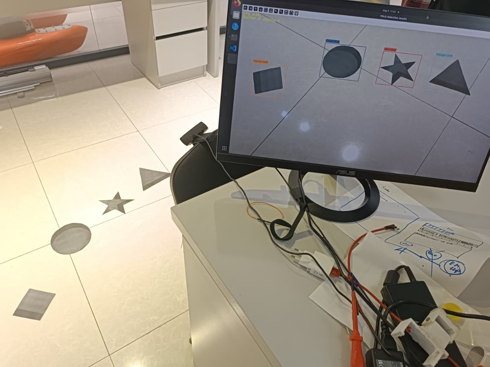
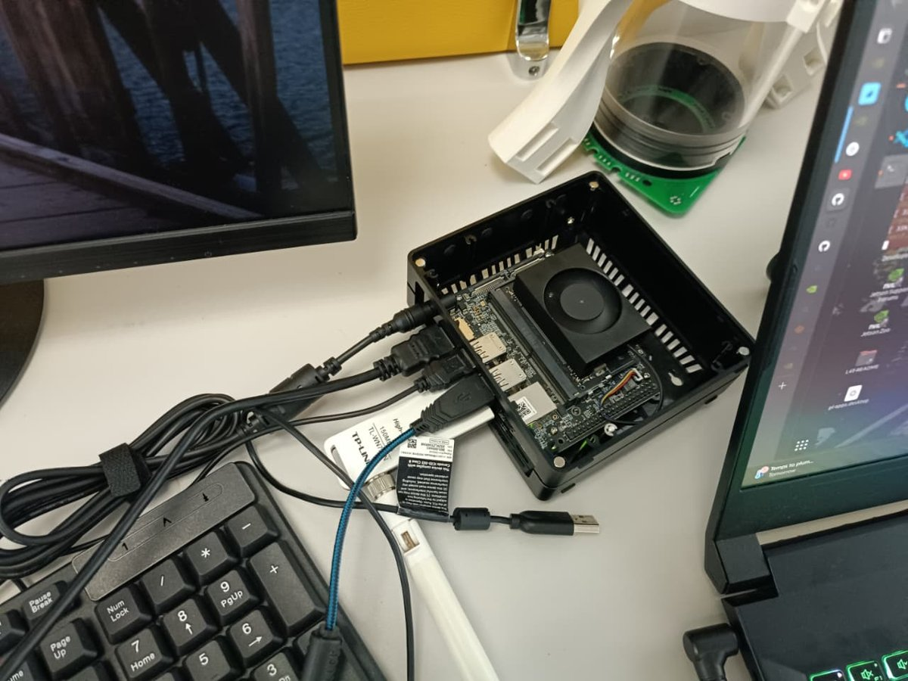
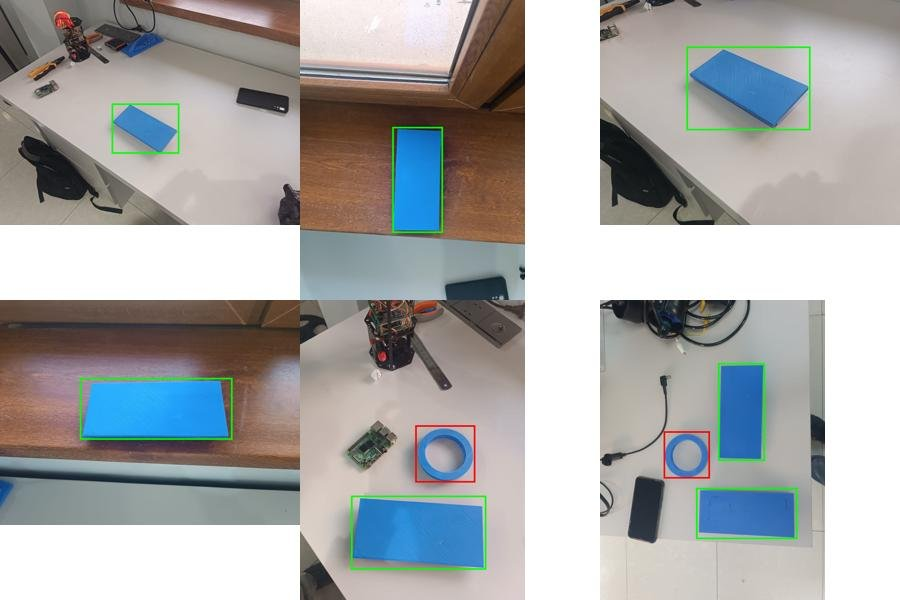

<h1 align="center">Teknofest Underwater Vehicle — Shape Detection & Steering</h1>

<p align="center">
  Real-time YOLO object detection on an NVIDIA Jetson Orin Nano for an autonomous underwater vehicle,<br>
  with auto-labelling to grow the dataset and serial steering commands to the vehicle's Arduino.
</p>

<p align="center">
  
  
  
  
</p>

---

<table>
  <tr>
    <td width="50%"></td>
    <td width="50%"></td>
  </tr>
  <tr>
    <td><sub>Live detection of the competition's shape targets (square, circle, star, triangle) laid out on the floor.</sub></td>
    <td><sub>The Jetson Orin Nano that runs inference on board the vehicle.</sub></td>
  </tr>
</table>

## Overview

The vehicle has to find shape targets with its camera and steer towards them. This repository contains the computer vision part, which I worked on for the team's **TEKNOFEST** underwater vehicle entry:

```
 camera ──► YOLO (Ultralytics) on Jetson ──► detections ──┬──► on-screen overlay (boxes, FPS, count)
                                                          ├──► auto-labelled frames ──► more training data
                                                          └──► "Left"/"Right" over serial ──► vehicle Arduino
```

## What's in here

| Path | What it is |
|---|---|
| [`auto_label_steer.py`](auto_label_steer.py) | Detection loop with auto-labelling and Arduino steering |
| [`dataset/`](dataset) | My first labelled dataset: 38 photos, 2 classes, YOLO format |
| [`requirements.txt`](requirements.txt) | Python dependencies |

## My work

**Dataset.** I photographed 3D-printed targets in different positions and on different backgrounds, then labelled them in Label Studio and exported in YOLO format.



**Auto-labelling.** The hardest part of the project was training: getting good precision needs a lot of labelled images, and we didn't have a powerful computer to iterate quickly. So I made the detector help build its own dataset. Every frame with a detection at or above `--label-thresh` (default 0.8) is saved as an image plus a YOLO `.txt` label in `auto_labels/`. After a quick review, those pairs can go straight into the next training round, with no manual box drawing.

**Steering.** The most confident object's horizontal position decides the command. If it's in the left half of the frame, the script sends `Left\n`; otherwise it sends `Right\n`. Commands go over serial to the vehicle's Arduino, rate-limited by `--send-interval`.

**Deployment.** The model runs on board on the Jetson Orin Nano under Ubuntu, reading from a USB camera.

## Usage

```bash
pip install -r requirements.txt

# Webcam, no steering
python auto_label_steer.py --model my_model.pt --source usb0 --resolution 1280x720

# With the Arduino connected (Windows: COM10, Linux/Jetson: /dev/ttyACM0)
python auto_label_steer.py --model my_model.pt --source usb0 --port /dev/ttyACM0

# Run over a folder of images just to collect labels (press any key to advance)
python auto_label_steer.py --model my_model.pt --source new_photos/ --label-thresh 0.85
```

| Option | Default | Purpose |
|---|---|---|
| `--thresh` | 0.5 | Minimum confidence to draw or use a detection |
| `--label-thresh` | 0.8 | Minimum confidence to auto-label |
| `--label-dir` | `auto_labels` | Where image/label pairs are written |
| `--no-autolabel` | off | Detection and steering only |
| `--port` / `--baud` | none / 9600 | Arduino serial link; omit `--port` to run without it |
| `--send-interval` | 0.1 s | Minimum time between steering commands |
| `--record` | off | Save the annotated video to `demo1.avi` (needs `--resolution`) |

Keys: `q` quit, `s` pause, `p` save a screenshot.

## Training

```bash
yolo detect train data=dataset/data.yaml model=yolov8n.pt epochs=100 imgsz=640
```

Set `path:` in `dataset/data.yaml` to the dataset's absolute path first. The trained weights aren't stored in the repo (they're over GitHub's file-size limit); they'll be attached to a [release](../../releases) instead.

## Roadmap

- [ ] Add a separate validation split and publish training metrics
- [ ] Add the 4-class dataset (square, circle, star, triangle) shown in the photo above
- [ ] Add the line-following module
- [ ] Export to TensorRT for faster inference on the Jetson

## Credits

The detection and display loop is based on `yolo_detect.py` from [EdjeElectronics/Train-and-Deploy-YOLO-Models](https://github.com/EdjeElectronics/Train-and-Deploy-YOLO-Models) (Apache-2.0). The auto-labelling, steering, CLI options and loop restructuring are mine. See [NOTICE](NOTICE).

## License

[Apache-2.0](LICENSE)
